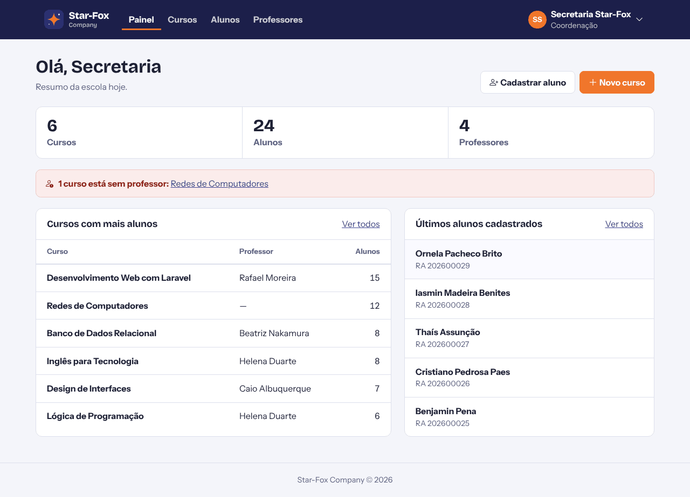
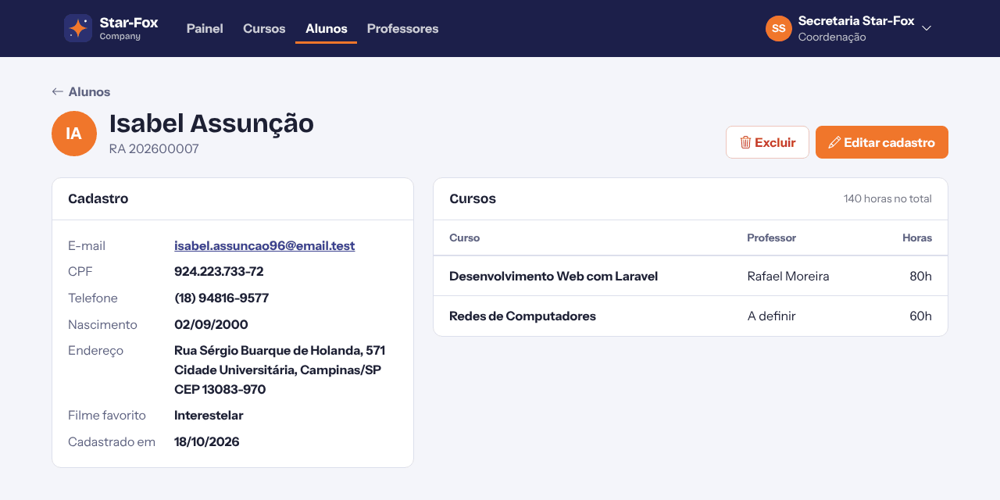
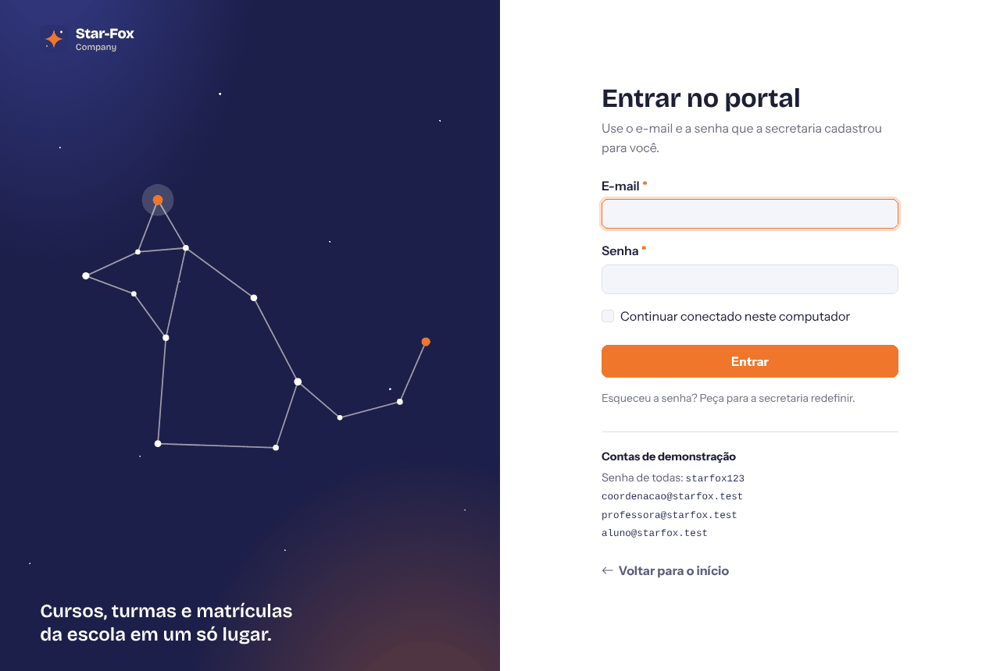
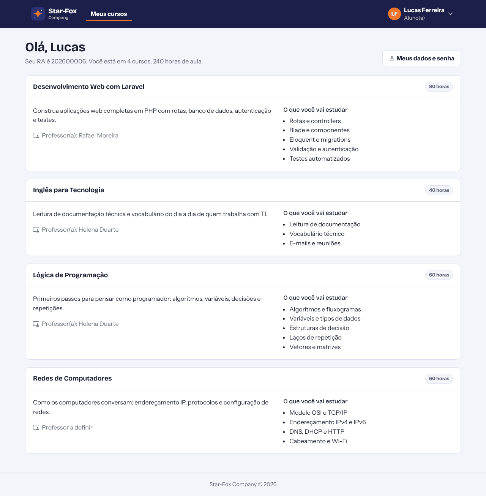

# Star-Fox Company

Portal escolar feito em Laravel: a coordenação cadastra cursos, alunos e professores e faz as
matrículas; cada professor vê as próprias turmas; cada aluno vê os próprios cursos.

Projeto do primeiro semestre da faculdade, reescrito para corrigir os bugs e as falhas de
segurança da primeira versão.


| Painel da coordenação | Ficha do aluno |
|---|---|
|  |  |
| **Login** | **Painel do aluno** |
|  |  |

## O que dá para fazer

| Quem | O que vê |
|---|---|
| Visitante | Página inicial com os cursos oferecidos e o botão para entrar |
| Coordenação | Painel com o resumo da escola; cadastro, busca, edição e exclusão de **cursos**, **alunos** e **professores**; matrícula de alunos nos cursos |
| Professor | Os cursos que leciona e a lista de alunos de cada turma |
| Aluno | Os cursos em que está matriculado, com professor e conteúdo |
| Todos | Página de perfil com troca de senha |

Detalhes: o RA do aluno é gerado sozinho, o CPF é validado pelos dígitos verificadores, o CEP
preenche o endereço pela API ViaCEP, e tudo está em português (inclusive as mensagens de erro).
Não existe cadastro público: só a coordenação cria contas.

## Rodando com Docker

```sh
cp .env.example .env
docker compose up -d
docker compose exec app composer install
docker compose exec app php artisan key:generate
docker compose exec app php artisan migrate --seed
```

- Site: <http://localhost:8080>
- phpMyAdmin: <http://localhost:8081>

## Rodando sem Docker (PHP 8.0 a 8.3 e Composer)

```sh
cp .env.example .env
```

No `.env`, troque o banco para SQLite e o cache/sessão para arquivo:

```dosini
DB_CONNECTION=sqlite
DB_DATABASE=/caminho/completo/para/database/database.sqlite
CACHE_DRIVER=file
SESSION_DRIVER=file
QUEUE_CONNECTION=sync
```

Depois:

```sh
touch database/database.sqlite
composer install
php artisan key:generate
php artisan migrate --seed
php artisan serve
```

## Contas de demonstração

Criadas pelo `php artisan migrate --seed`. A senha de todas é `starfox123`.

| Papel | E-mail |
|---|---|
| Coordenação | `coordenacao@starfox.test` |
| Professora | `professora@starfox.test` |
| Aluno | `aluno@starfox.test` |

São só para desenvolvimento. Num servidor de verdade, não rode o seeder (ou troque as senhas).

## Testes

```sh
php artisan test
```

São 41 testes: login de cada papel, bloqueio depois de 5 tentativas, quem pode acessar o quê,
CRUD de cursos, alunos e professores, validação de CPF/CEP/e-mail, troca de senha e os bugs
antigos (cadastro público, rota que expunha dados, criação de curso sem login).

## Organização do código

```
app/Http/Controllers/
    Auth/LoginController.php          entrar e sair
    Coordenacao/                       painel + CRUD de cursos, alunos e professores
    Professor/PainelController.php     cursos e turmas do professor
    Aluno/PainelController.php         cursos do aluno
    PerfilController.php               perfil e troca de senha
app/Http/Middleware/EnsurePapel.php    libera cada área só para o papel certo
app/Http/Requests/                     validação dos formulários
app/Rules/Cpf.php                      validação de CPF
app/Models/User.php, Curso.php
resources/views/                       telas (Blade + Bootstrap 5)
public/css/app.css, public/js/app.js   tema e comportamentos (máscaras, CEP, filtros)
```

O Bootstrap, os ícones e as fontes (Bricolage Grotesque e Instrument Sans) ficam em `public/`,
então o site funciona sem depender de CDN e sem etapa de build de front-end.

---
Feito por: Giovani Belini, Jean Okabe Rezende Piton, Matheus Zanon Caritá, Victor Roston.
